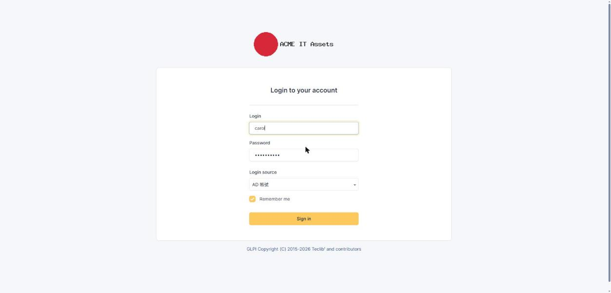
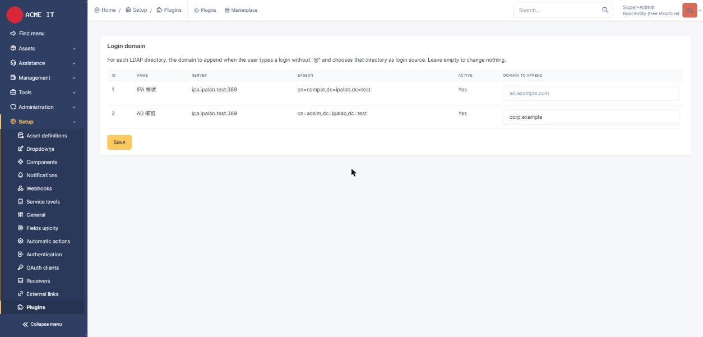

# Login domain (GLPI plugin)

[繁體中文](README.zh-TW.md)

When a user picks a given LDAP directory as login source on the GLPI login page and types only the account name (e.g. `alice`), the plugin appends the configured domain on the server side (`alice@ad.example.com`) before GLPI authenticates.

Typical use: GLPI authenticates through the **FreeIPA compat tree** and FreeIPA has a **trust with Active Directory**. AD users are named `user@ad.domain` in the compat tree, so without this plugin users must always type the full name.



## Compatibility

| Item | Version |
| --- | --- |
| GLPI | **11.0.0 – 11.0.99** (tested with 11.0.13, official Docker image `glpi/glpi:11.0.13`, PHP 8.5.12) |
| PHP | as required by GLPI 11 (8.2+) |
| GLPI 10 | not supported (GLPI 10 refuses to install it: minimum 11.0.0) |

## How it works

```text
login page: login "alice", source "AD accounts" (ldap-2)
   │  POST /front/login.php
   ▼
GLPI boots plugins (before front/login.php runs)
   │  logindomain: ldap-2 has a domain, login has no "@" and no "\"  -> login_name = alice@ad.example.com
   ▼
front/login.php -> AuthLDAP searches (uid=alice@ad.example.com) and binds with the password
```

- Only the POST of the login form is touched, and only for LDAP directories that have a domain configured.
- Logins that already contain `@`, `DOMAIN\user`, empty logins, the GLPI internal database and mail server sources are left as typed.
- Surrounding spaces are trimmed; GLPI's LDAP search is case-insensitive, so `ALICE` and `alice` reach the same GLPI user (tested).
- Server side only, no JavaScript.
- The GLPI user name is the full name (`alice@ad.example.com`), exactly as if the user had typed it, so adding or removing the plugin never creates duplicate users.

## Install

```bash
# the directory name must be "logindomain"
cd /data/glpi_stack                      # Docker: host dir mounted on /var/www/glpi/plugins
tar xzf logindomain-1.0.0.tar.gz -C glpi_plugins
chown -R 33:33 glpi_plugins/logindomain  # www-data in the official image (package install: apache)
docker exec -u www-data glpi_app php bin/console plugin:install --username=glpi logindomain
docker exec -u www-data glpi_app php bin/console plugin:activate logindomain
docker exec -u www-data glpi_app php bin/console plugin:list
```

Package install (no Docker): extract into `<GLPI>/plugins/logindomain` and run the same commands with `sudo -u apache php bin/console ...`.

## Configure

1. **Create two LDAP directories** (Setup > Authentication > LDAP directories), both pointing to the FreeIPA compat tree with the same settings, different names only, e.g. "AD accounts" and "IPA accounts". The names appear in the "Login source" list of the login page.
2. **Setup > Plugins > Login domain**: type the AD domain (e.g. `ad.example.com`) on the "AD accounts" row, leave "IPA accounts" empty, save.
3. (Recommended) make "AD accounts" the default LDAP directory so most users never change the login source.



- Domains are lower-cased, a leading `@` is removed, invalid names (spaces, single label, special characters) are rejected with an error.
- The page requires the `config` UPDATE right.
- Every change is written to the GLPI event log (Administration > Logs, service `setup`): `logindomain mapping changed from {...} to {...}`; to revert, type the old values back.
- Storage: `glpi_configs`, context `plugin:logindomain`, name `domains`, JSON `{"<LDAP directory id>":"<domain>"}`.

## Not affected (limitations)

| Item | Note |
| --- | --- |
| REST API (`apirest.php`, `api.php/v2`), CLI | only the web login form is handled; API clients still send the full name |
| "Show login source" disabled (Setup > General) | the form sends no source, so nothing is appended |
| Rights, groups, HBAC | still handled by GLPI authorization rules and FreeIPA; the plugin only changes the login string |
| Wrong password | still a single LDAP bind (no extra attempt that could lock AD accounts sooner) |

## Disable / remove (reversible)

| Action | Result (tested) |
| --- | --- |
| `plugin:deactivate logindomain` | stops immediately; settings kept, reactivating restores the behaviour |
| `plugin:install --force` | keeps the existing mapping |
| `plugin:uninstall logindomain` | deletes the setting from `glpi_configs`; the plugin creates no tables, GLPI users are untouched |

Then delete the `plugins/logindomain` directory.

## Tests

```bash
php tests/run_tests.php        # 30 unit tests, no GLPI needed
```

Integration test on 2026-11-15 with GLPI 11.0.13 (Docker) + FreeIPA 4.13.4 container: `carol`, `CAROL` and `carol@corp.example` on the "AD accounts" source all log in as `carol@corp.example`; wrong password rejected; `alice` on "IPA accounts" unchanged; `carol` on "IPA accounts" fails (no domain appended, correct); local `glpi` unchanged; configuration page, deactivate, reinstall and uninstall behave as described above.

## Moving to another host

- The directory must be named `logindomain` (GitHub's automatic source zip is `glpi-logindomain-<version>`: use the release asset `logindomain-<version>.tar.gz`).
- PHP files only, no third-party dependency, nothing to build: copy it as is to offline hosts.
- The web server user must be able to read it (`33:33` in the official Docker image, `apache` on RHEL packages).
- Several GLPI front ends: install the plugin on each; the setting lives in the database, configure once.
- Before a GLPI major upgrade (12), check that the plugin supports it, otherwise GLPI deactivates it (users then have to type the full name).

## License

GPL-3.0-or-later, see [LICENSE](LICENSE).
