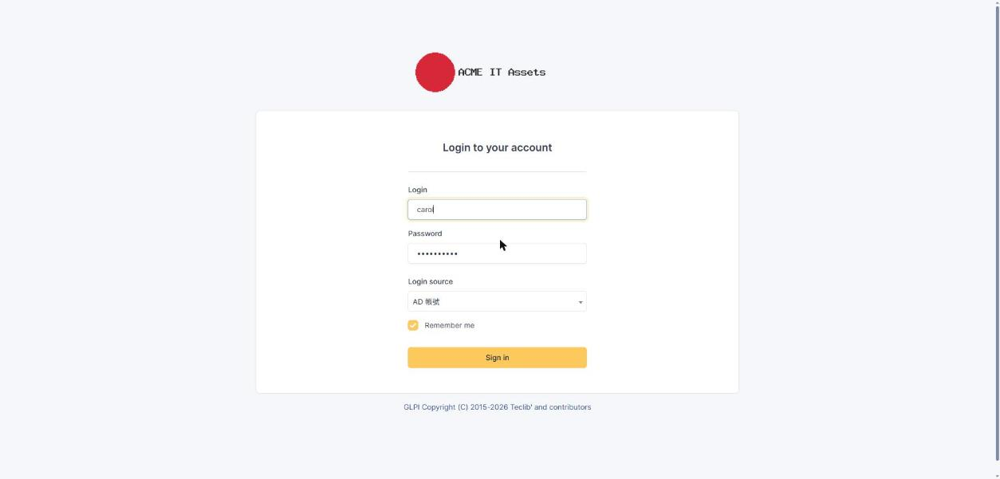
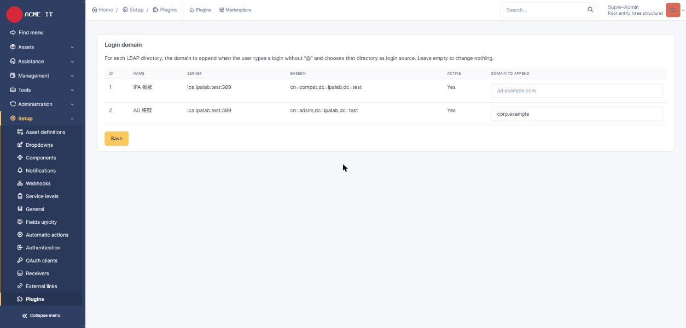

# Login domain（GLPI 外掛）

[English](README.md)

在 GLPI 登入頁選了特定的 LDAP 目錄時，使用者只要輸入帳號（例如 `alice`），外掛會在後端自動補上網域（`alice@ad.example.com`）再交給 GLPI 驗證。

典型用途：GLPI 透過 **FreeIPA 的 compat tree** 驗證帳號，而 FreeIPA 和 **Active Directory 建立了 trust**。AD 帳號在 compat 裡的名稱是 `帳號@AD網域`，沒有這個外掛時，使用者每次都要自己打完整名稱。



## 適用版本

| 項目 | 版本 |
| --- | --- |
| GLPI | **11.0.0 ～ 11.0.99**（實測 11.0.13，官方 Docker 映像 `glpi/glpi:11.0.13`，PHP 8.5.12） |
| PHP | 跟著 GLPI 11（8.2 以上） |
| GLPI 10 | 不支援（`setup.php` 宣告最低 11.0.0，GLPI 10 會拒絕安裝） |

## 運作方式

```text
登入頁：帳號 alice、登入來源「AD 帳號」(ldap-2)
   │  POST /front/login.php
   ▼
GLPI 啟動外掛（在 front/login.php 執行之前）
   │  logindomain：來源 ldap-2 有設定網域、帳號裡沒有 @ 也沒有 \  → login_name = alice@ad.example.com
   ▼
front/login.php → AuthLDAP 用 (uid=alice@ad.example.com) 找人、用密碼 bind
```

- 只動「登入表單的 POST」，而且只在**選了有設定網域的 LDAP 目錄**時才補。
- 已經有 `@` 的帳號（`alice@ad.example.com`、`bob@other.example`）、`網域\帳號` 格式、空白帳號、GLPI 本機帳號、郵件伺服器來源：一律不動。
- 帳號前後空白會去掉；GLPI 的 LDAP 搜尋不分大小寫，`ALICE` 和 `alice` 會登入同一個 GLPI 帳號（實測）。
- 純伺服器端處理，不需要 JavaScript。
- GLPI 裡的帳號名稱會是完整名稱（`alice@ad.example.com`），和使用者自己打完整名稱時一樣，所以裝或拆這個外掛都不會產生重複帳號。

## 安裝

```bash
# directory name must be "logindomain"
cd /data/glpi_stack                      # Docker: host dir mounted on /var/www/glpi/plugins
tar xzf logindomain-1.0.0.tar.gz -C glpi_plugins
chown -R 33:33 glpi_plugins/logindomain  # www-data in the official image (package install: apache)
docker exec -u www-data glpi_app php bin/console plugin:install --username=glpi logindomain
docker exec -u www-data glpi_app php bin/console plugin:activate logindomain
docker exec -u www-data glpi_app php bin/console plugin:list       # logindomain ... Enabled
```

套件安裝（非 Docker）：解壓到 `<GLPI>/plugins/logindomain`，用 `sudo -u apache php bin/console ...` 執行同樣的指令。

## 設定

1. **建兩組 LDAP 目錄**（設定 → 驗證 → LDAP 目錄），兩組都指向 FreeIPA compat、設定相同，只有名稱不同：例如「AD 帳號」、「IPA 帳號」。名稱會出現在登入頁的「登入來源」下拉選單。
2. **設定 → 外掛 → Login domain**（或外掛清單裡的設定圖示）：在「AD 帳號」那一列填 AD 網域（例如 `ad.example.com`），「IPA 帳號」留空，儲存。
3. （建議）把「AD 帳號」設成預設的 LDAP 目錄，大部分使用者就不用切換登入來源。



- 網域會轉成小寫、去掉開頭的 `@`，格式不對（空白、只有一段、特殊字元）會顯示錯誤且不儲存。
- 需要「設定」的更新權限（`config` UPDATE）才能開這個頁面。
- 每次變更會寫進 GLPI 事件紀錄（管理 → 記錄，服務 `setup`）：`logindomain mapping changed from {...} to {...}`，要還原照著舊值填回去即可。
- 設定存在 `glpi_configs`（context `plugin:logindomain`，名稱 `domains`，JSON：`{"<LDAP 目錄 ID>":"<網域>"}`）。

## 不會影響的地方（限制）

| 項目 | 說明 |
| --- | --- |
| REST API（`apirest.php`、`api.php/v2`）、CLI | 只處理網頁登入表單；API 仍要給完整名稱 |
| 隱藏了「登入來源」下拉選單（設定 → 一般 → 「顯示登入來源」關閉） | 表單不會送出來源，外掛不會補網域 |
| 權限、群組、HBAC | 照舊由 GLPI 授權規則和 FreeIPA 處理，外掛只改帳號字串 |
| 密碼錯誤 | 一樣只驗證一次，不會因為補網域多送一次 LDAP 驗證（不會提早觸發 AD 帳號鎖定） |

## 停用 / 移除（可回復）

| 動作 | 結果（實測） |
| --- | --- |
| `plugin:deactivate logindomain` | 立刻停止補網域；設定保留，重新啟用就恢復 |
| `plugin:install --force` 重新安裝 | 保留原本的網域設定 |
| `plugin:uninstall logindomain` | 刪除 `glpi_configs` 裡的設定；外掛不建任何資料表，GLPI 帳號不受影響 |

之後再刪掉 `plugins/logindomain` 目錄即可。

## 測試

```bash
php tests/run_tests.php        # 30 unit tests, no GLPI needed
```

2026-11-15 在 GLPI 11.0.13（Docker）+ FreeIPA 4.13.4 容器整合測試：

| 情境 | 結果 |
| --- | --- |
| 來源「AD 帳號」輸入 `carol` / `CAROL` / `carol@corp.example` | 都登入同一個帳號 `carol@corp.example` |
| 來源「AD 帳號」密碼錯誤 | `Incorrect username or password` |
| 來源「IPA 帳號」輸入 `alice` | 照舊登入（不補網域） |
| 來源「IPA 帳號」輸入 `carol` | 失敗（沒有補網域，正確） |
| GLPI 本機帳號 `glpi` | 照舊登入 |
| 設定頁：合法 / 不合法網域、沒變更時不寫紀錄 | 符合預期 |
| 停用、重新安裝、解除安裝 | 見上表 |

## 搬到其他機器 / 環境的注意事項

- 目錄名稱一定要是 `logindomain`（GitHub 自動產生的 source zip 會是 `glpi-logindomain-<版本>`，要改名；請用 Release 附的 `logindomain-<版本>.tar.gz`）。
- 只有 PHP 檔，沒有第三方套件、不需要編譯，離線環境直接複製即可。
- 擁有者要讓 web server 讀得到（官方 Docker 映像 `33:33`，RHEL 套件安裝 `apache`）。
- 多台 GLPI（負載平衡）每台都要放外掛；設定存在資料庫，只要設一次。
- GLPI 升級到新的大版本（12）前要確認外掛已支援，否則 GLPI 會自動停用它（使用者就要自己打完整名稱）。

## 授權

GPL-3.0-or-later，見 [LICENSE](LICENSE)。
